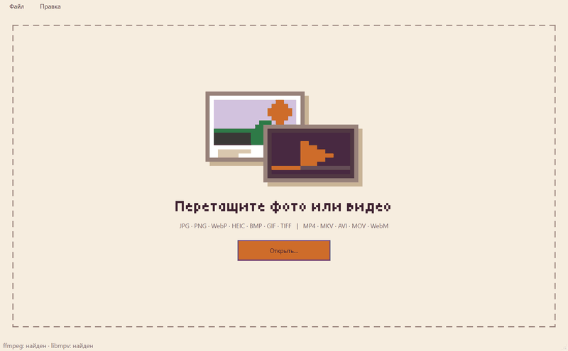
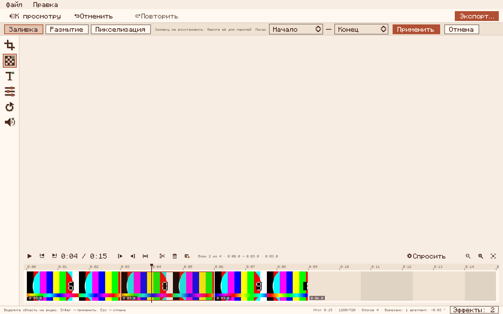
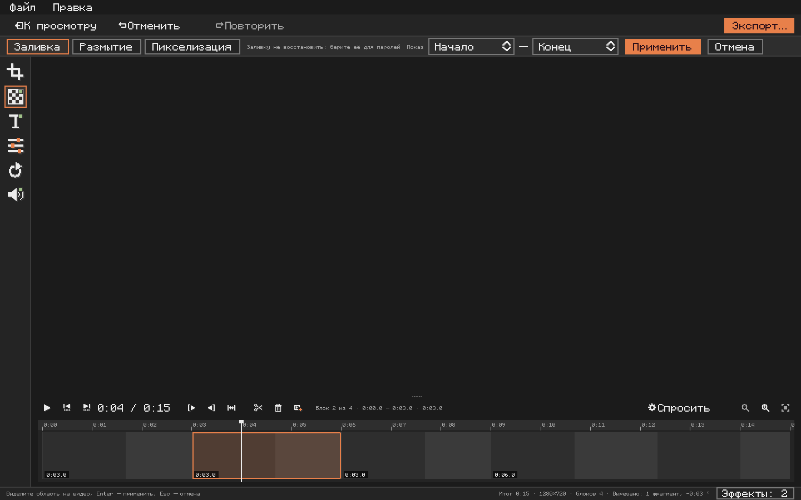
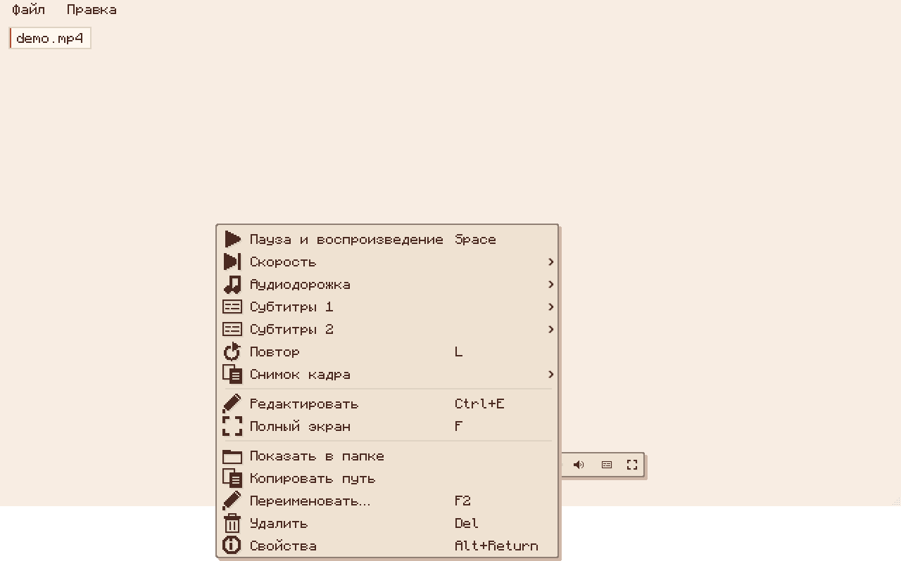
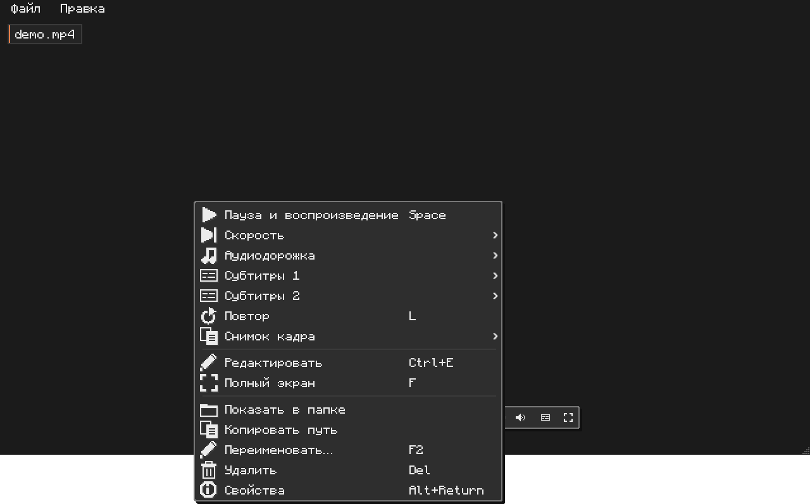
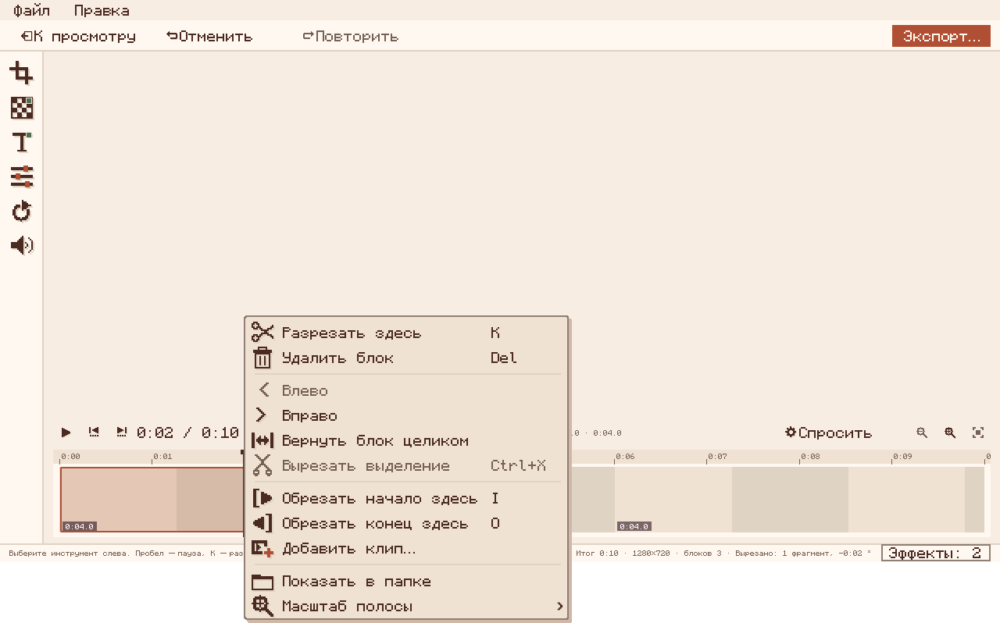
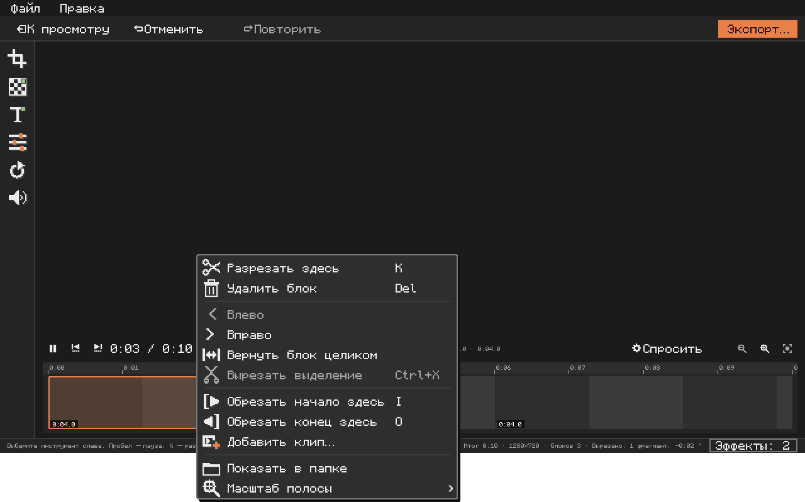

# CHOPCHOP

A light photo viewer and video player with a built-in quick editor. Open a file, look at it, fix it
if needed and save. Offline, free, no watermarks, no sign-up and no telemetry; the original file is
never changed. Windows and Linux.



## Features

- **Photos:** JPG, PNG, WebP, BMP, GIF, TIFF and HEIC; flip through a folder with the arrow keys,
  zoom, full screen.
- **Video:** almost any format, audio track selection, subtitles 1 and 2 at the same time with
  adjustable styling, external .srt and .ass files, subtitle delay, remembered position.
- **Photo editor:** crop with aspect ratios, rotate, hide an area (fill, pixelate, blur), brush and
  marker, arrow, text, colour and filters, resize, undo and redo.
- **Video editor:** split and **cut out the middle**, join clips, volume and audio replacement,
  hide an area and text **with a display time**, colour and filters, rotate. Fast export without
  quality loss or precise export with re-encoding.
- **Context menu** on the right mouse button on every screen with an open file: copy, show in
  folder, rename, move to the recycle bin, properties, frame snapshot.
- **Look:** light and dark themes, four accent palettes, Russian and English interface, detailed
  settings ([`docs/settings.md`](docs/settings.md), in Russian). Everything switches on the fly.
- Metadata (EXIF, GPS, shooting location) is removed on save.

### Screenshots

| Light theme | Dark theme |
| --- | --- |
|  |  |
|  |  |
|  |  |

## Installation

Ready-made builds are on the [Releases](https://github.com/keishsjsk/chopchop/releases) page.

| System | File | How to use |
| --- | --- | --- |
| Windows 10/11 | `CHOPCHOP-<version>-setup.exe` | Installer that needs no administrator rights. The program appears in "Open with" for photos and videos. |
| Windows | `CHOPCHOP-<version>-win64-portable.zip` | Unpack and run `CHOPCHOP.exe`; nothing is installed. |
| Linux x86_64 | `CHOPCHOP-<version>-x86_64.AppImage` | `chmod +x CHOPCHOP-*.AppImage && ./CHOPCHOP-*.AppImage`. Needs glibc no older than the build machine's (Ubuntu 24.04 or newer). |

ffmpeg and libmpv are already inside the builds. Checksums are in the release's `SHA256SUMS.txt`.
Windows may show a SmartScreen warning: the builds are not signed with a certificate yet.

Command line: `CHOPCHOP.exe path\to\file`, version: `--version`.

## Player keys

Space: pause, ←/→: seek 5 s, ↑/↓: volume, A: next audio track,
S and Shift+S: subtitles 1 and 2, Z/X and Shift+Z/Shift+X: shift subtitles 1 and 2 by 100 ms,
F: full screen. You can drop an .srt/.ass file onto the window while watching.

General: right mouse button (or Menu, Shift+F10): context menu, Ctrl+E: editor,
F2: rename, Delete: move to the recycle bin, Alt+Enter: properties, Ctrl+C: copy the
image (in the player, the frame). The full list of actions and keys is shown in the menu.

## Photo editor

Ctrl+E switches to the editor from photo viewing (and back), Ctrl+V opens an image from the clipboard.
The original file is not changed: the result is saved next to it as `name_edited.jpg`.

| Key | Action |
| --- | --- |
| C | crop: the frame starts as the whole picture, drag the edges and corners; list of aspect ratios (1:1, 4:3, 3:2, 16:9 …) and a ⇄ button to flip the ratio |
| R | rotate and flip |
| B | hide an area: fill (default), pixelate, blur |
| D | brush and marker (drawn freehand and applied at once), arrow, rectangle, area selection |
| T | text: type, then click on the photo |
| Enter / Esc | apply / cancel the action (Esc with no selection goes back to viewing) |
| Ctrl+Z / Ctrl+Y | undo / redo |
| Ctrl+S | quick save, Ctrl+Shift+S: choose format, quality and metadata |
| Ctrl+C | copy the result to the clipboard |

Blurred or pixelated text can be partly recovered; use a fill for passwords and numbers.

## Video editor

Ctrl+E on a video opens the editor, Esc or "Back to viewing" returns. The original file is not
changed; the result is saved as a new file `name_edited.mp4` (Ctrl+S or "Export…").

- The clip is a row of blocks on the timeline: each has thumbnails and a duration, with seams
  between them. K splits (where the mouse is over the timeline, otherwise at the playback position),
  a click selects a block, Delete removes it, a block can be dragged to another place, and the
  block's edges are dragged with the mouse (this is how trimmed material comes back). Shift + drag
  selects a range, Ctrl+X cuts it out. I and O trim the start and end of a block to the playback
  position. The status bar shows "Cut out: 2 fragments, −0:12". The preview plays the whole
  montage and the player time equals the result time.
  Details: [`docs/cutting.md`](docs/cutting.md) (in Russian).
- Joining: "Add clip…" adds a block at the end, the order is changed by dragging blocks.
- Sound: volume up to 200%, "Remove sound", "Replace sound…" with your own file.
- Effects (tools on the left): frame (C), hide an area (B), text (T), colour and filters, rotate.
  Text and hidden areas are shown for the whole clip or in a chosen time window; the window is
  stored in result time and recalculated when you cut. Effects are visible in the preview.
- Clips with different parameters (size, frame rate, codec) can be joined too: everything is
  fitted to the first clip's frame with black bars, and missing clips get silence for their audio.
- Export goes **without re-encoding the video** as long as there are no effects and no joined
  clips of different kinds: it takes seconds and loses no quality. In this mode you can cut only at
  keyframes, so the start may move by a fraction of a second. The "Precise trim" checkbox and any
  effects turn on re-encoding (H.264): boundaries are frame-accurate, but export takes longer, shows
  progress and can be cancelled. Audio is re-encoded (AAC) only when the volume changes, the track
  is replaced or the video is re-encoded.

## Development

```bash
python -m venv .venv
.venv/Scripts/activate        # Linux: source .venv/bin/activate
pip install -e ".[dev]"
python -m chopchop [path to file]
```

Checks:

```bash
ruff check . && ruff format --check .
mypy
pytest
python -m chopchop --self-check      # is everything needed found: Qt, Pillow, ffmpeg, libmpv
```

During development the program looks for `ffmpeg`, `ffprobe` and `libmpv` first in `resources/bin`,
then on the system (PATH):

- Windows: put `ffmpeg.exe`, `ffprobe.exe` and `libmpv-2.dll` into `resources/bin`
  (`python packaging/fetch_binaries.py --platform windows --out resources` downloads them and checks SHA-256).
- Linux: `sudo apt install ffmpeg libmpv2`.

Without ffmpeg the video editor and the video tests do not work (the tests are skipped), without
libmpv the player does not work.

## Building a release

```bash
pip install -e ".[build]"
powershell -File packaging/build_windows.ps1     # folder, portable zip and installer (needs Inno Setup 6)
bash packaging/build_appimage.sh                 # AppImage (Linux, needs libmpv2)
```

The scripts download pinned versions of ffmpeg and libmpv and verify their checksums, build the
program with PyInstaller (folder mode), check the result with the `--self-check` command and pack it.
A release is made from a tag: `git tag v0.2.0 && git push origin v0.2.0`; GitHub Actions
(`.github/workflows/release.yml`) builds the installer, the zip and the AppImage, attaches the SBOM
(`sbom.cdx.json`) and `SHA256SUMS.txt`, and takes the notes from `CHANGELOG.md`. The GitHub release
is created as a draft and published by hand.

The application icon (variant "a": a film frame with a "play" triangle, Ember palette) lives in
`docs/design/icons/app-a.svg`, and `packaging/make_icon.py` builds `.ico` (16–256), PNG 16–512 and
SVG from it in `resources/icons/`; the demo GIF is recorded by `docs/make_demo.py`, and the editor
and menu screenshots by `docs/design/make_editor_screens.py` and `make_menu_screens.py`.

## Documentation

The documents below are written in Russian.
[`docs/architecture.md`](docs/architecture.md): how the program is built,
[`docs/performance.md`](docs/performance.md): budgets and measurements,
[`docs/cutting.md`](docs/cutting.md): cutting video, [`docs/subtitles.md`](docs/subtitles.md): subtitles,
[`docs/settings.md`](docs/settings.md): all settings,
[`docs/checklist.md`](docs/checklist.md): manual pre-release check (Windows, X11, Wayland).

## License

GNU GPL version 3 or later (`LICENSE`). Third-party components are listed in `THIRD_PARTY_NOTICES.md`.
